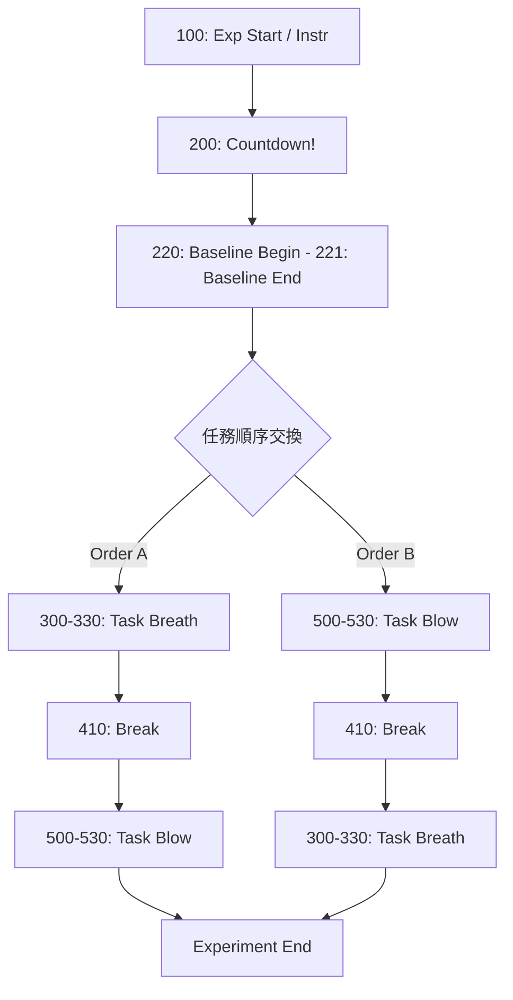

# Neuroimaging & ECG HW1: 吹氣與呼吸運動實驗

本專案為神經影像與心電訊號（ECG）實驗系統，整合 **PsychoPy** 實驗刺激呈現與 **Polar H10** 心率/心電監測設備，用於記錄並分析受試者在不同運動任務（呼吸/吹氣）下的生理訊號。

---

## 目錄 (Table of Contents)
1. [專案目錄與資料位置](#-1-專案目錄與資料位置)
2. [實驗流程與 Event Codes](#-2-實驗流程與-event-codes)
3. [環境建置與安裝](#-3-環境建置與安裝)
4. [實驗執行步驟 (Quick Start)](#-4-實驗執行步驟-quick-start)
5. [修改與維護實驗 (PsychoPy Builder)](#-5-修改與維護實驗-psychopy-builder)
6. [資料輸出與 Marker 對齊說明](#-6-資料輸出與-marker-對齊說明)

---

## 1. 專案目錄與資料位置

進行資料查找或分析時，請先依照資料類型確認所在的資料夾。專案根目錄的主要檔案與資料夾如下：

```text
Neuroimaging_ECG_HW1/
├── marker_log/                         # PsychoPy 產生的 Event Marker 紀錄
│   └── sub-*_sess-*_marker_*.csv       # 依受試者、場次與時間命名
├── data/                               # Polar H10 匯出的生理訊號資料
│   ├── *_RAW.csv                      # 原始 ECG 訊號
│   └── *_peaks.csv                    # 偵測到的心跳峰值資料
├── Experiment_v1.psyexp                # PsychoPy Builder 實驗設定檔
├── Experiment_v1_lastrun.py            # PsychoPy 產生的實驗執行程式
├── psychopy_marker_code.py             # PsychoPy Marker 發送與紀錄相關程式
├── polar_bridge.py                     # Polar H10 訊號橋接服務
├── VerityCollectionToolv0.057.html     # Polar H10 監控頁面（請由橋接服務開啟）
├── VerityCollectionToolv0.051.html     # 舊版 Polar H10 監控頁面
└── *.png                               # 實驗中使用的視覺刺激圖片
```

### 要找哪一種資料？

| 資料內容 | 存放位置 | 說明 |
| :--- | :--- | :--- |
| 實驗階段與事件時間點 | `marker_log/` | 每次實驗產生一個 CSV，檔名包含受試者（`sub-*`）、場次（`sess-*`）與記錄時間 |
| Polar H10 原始 ECG 訊號 | `data/*_RAW.csv` | 用於後續訊號處理與分析的原始資料 |
| Polar H10 心跳峰值 | `data/*_peaks.csv` | 已整理出的心跳峰值資料，可用於心率或 HRV 分析 |
| 實驗流程與參數 | `Experiment_v1.psyexp` | 使用 PsychoPy Builder 修改實驗時應開啟的檔案 |
| 實驗程式與橋接程式 | `Experiment_v1_lastrun.py`、`psychopy_marker_code.py`、`polar_bridge.py` | 用於執行實驗、發送 Marker，以及連接 Polar H10 |

> **資料整理建議**：分析時請使用相同受試者與場次的 `marker_log/` 和 `data/` 檔案配對。`marker_log/` 的 timestamp 可用來對齊 `data/` 中的 Polar H10 訊號；不要只依檔案建立時間判斷配對關係。

---

## 2. 實驗流程與 Event Codes

###  實驗 Demo
- **吹氣球運動 Demo 影片**：[點此觀看(https://youtu.be/jt4U0glHhaA)]

### 實驗流程圖 (Experiment Flowchart)
為了避免**順序效應（Order Effect）**，本實驗支援任務順序交換（Counterbalancing）。請根據受試者編號指派對應流程：
- **Order A**：Baseline ➔ **Task Breath (呼吸任務)** ➔ Break ➔ **Task Blow (吹氣任務)**
- **Order B**：Baseline ➔ **Task Blow (吹氣任務)** ➔ Break ➔ **Task Breath (呼吸任務)**



### Event Code 對照表
不論任務順序如何調換，**各階段之 Event Code 皆保持固定**，以便後續撰寫統一的數據分析腳本。

| 階段 (Stage) | 區段名稱 (Block/Phase) | 開始代碼 (Begin Code) | 結束代碼 (End Code) | 說明 / 備註 |
| :--- | :--- | :---: | :---: | :--- |
| **全域 (Global)** | Experiment Start (Instr) | `100` | `200` | 實驗開始與總指導語呈現 |
| | Break | `410` | - | 任務間休息時間 |
| **1. Baseline** | Baseline | `220` | `221` | 基期靜態數據量測 |
| **2. Task Breath**<br>*(呼吸任務)* | 3.1 Breath-Pre | `310` | `311` | 呼吸任務前置準備 / 指導語 (`300`) |
| | 3.2 Countdown / Task | `320` | `321` | 倒數計時與呼吸任務執行 |
| | 3.3 Breath-Post | `330`  | `331` | 呼吸任務後續記錄 |
| **3. Task Blow**<br>*(吹氣任務)* | 5.1 Blow-Pre | `510` | `511` | 吹氣任務前置準備 / 指導語 (`500`) |
| | 5.2 Blow Task | `520` | `521` | 吹氣任務執行 |
| | 5.3 Blow-Post | `530` | `531` | 吹氣任務後續記錄 |
| **4. Exp End** | Experiment End | - | - | 實驗結束 |

> **Trial/Part 推進順序**：
> 實驗試驗序列依據 `1 -> 5 -> 9 -> 13 -> 17 -> 21 -> 25` 推進。開發腦波 (EEG) 或生理訊號標記時，請確保按照此序列準確發送對應 Trigger。

---

## 3. 環境建置與安裝

### 1. 安裝 PsychoPy
- 下載連結：[PsychoPy Download Page](https://psychopy.org/download.html)
- 建議版本：**PsychoPy Standalone (Stable)**

> **Troubleshooting（若 PsychoPy 遇到啟動問題）**：  
> 若 Standalone 版本無法順利點擊啟動，可於專案根目錄建立 `start_psychopy.bat` 批次檔，複製貼上以下內容（**請將路徑更改為你的 PsychoPy 安裝路徑**）：
> ```bat
> @echo off
> set PYTHONUTF8=1
> "C:\Program Files\PsychoPy\python.exe" -c "import psychopy.app; psychopy.app.startApp()"
> ```

### 2. Python 環境設定
確保本機環境已安裝 Python 3.x，並安裝相關依賴庫（用於執行 Polar H10 橋接服務）。

---

## 4. 實驗執行步驟 (Quick Start)

請按照以下順序執行實驗：

### Step 1: 啟動 Polar H10 訊號橋接器
執行 `polar_bridge.py` 以自動在 Polar H10 上建立並同步 Event Marker：
```bash
python polar_bridge.py
```
- 執行後命令列會顯示 `http://localhost:XXXX` 的本機網址。
- 開啟瀏覽器貼上該網址，進入 Polar H10 監控頁面。
- **檢查重點**：確認頁面左下角顯示 **成功與 PsychoPy 建立連結**。

> **Notice**：  
> **請勿直接雙擊打開** `VerityCollectionToolv0.057.html`！否則系統將無法自動發送與建立 Marker 標記。

### Step 2: 開啟並啟動 PsychoPy 實驗
1. 開啟 **PsychoPy Runner** 視窗。
2. 點擊左上角 `+` 號，載入專案的 `.psyexp` 實驗檔。
3. 可於介面上切換 **Pilot (測試模式)** 或 **Run (正式實驗模式)**。
4. 按下 **Desktop Run** 的播放按鈕 `▶` 即可開始實驗。


---

## 5. 修改與維護實驗 (PsychoPy Builder)

如果需要修改實驗流程、時間長度或刺激內容：
1. 打開 **PsychoPy Builder** 介面。
2. 點選左上角 `File` ➔ `Open`，開啟對應的 `.psyexp` 檔案。
3. 可以在下方的 Routine 時間軸上針對各個階段（Baseline、Task Breath、Task Blow、Break 等）進行參數修改或新增 Component。

---

## 6. 資料輸出與 Marker 對齊說明

- **Marker 日誌**：實驗執行時，PsychoPy 會同步將時間點記錄於 `marker_log/` 資料夾中。
- **訊號對齊**：後續進行數據處理時，可利用 `marker_log/` 中的 timestamp 與 Polar H10 網頁接收到的 Marker 進行時間軸對齊（Synchronization）。